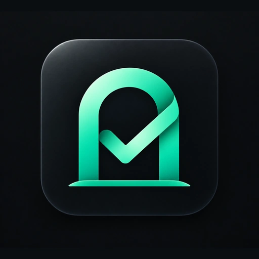
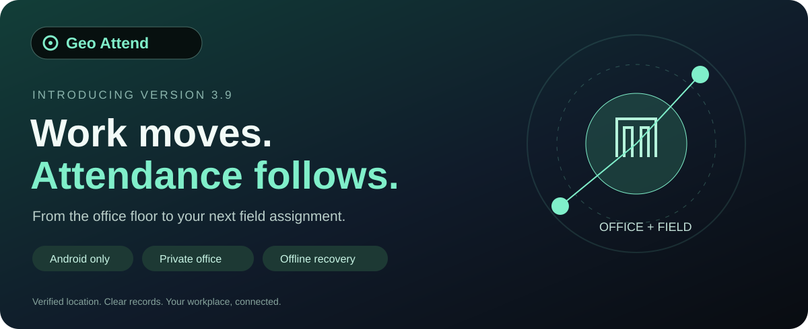
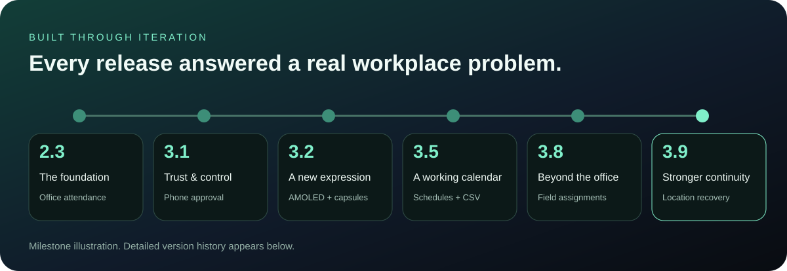
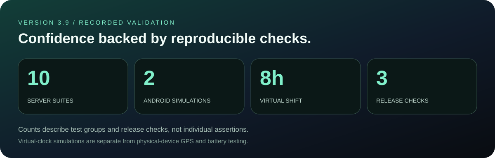

  

  <a href="https://github.com/radt9098-byte/geo-attend-v2.3/releases/tag/v3.9"><b>Explore v3.9</b></a> ·
  <a href="#the-evolution">Our evolution</a> ·
  <a href="#tested-with-evidence">Testing</a> ·
  <a href="#install-version-39">Install</a>

# Geo Attend
### Work moves. Attendance follows.

A working day can begin at the office, continue at a factory and end at a client site. Attendance should follow that reality.

**Geo Attend brings automatic, location-verified attendance to a private Android workplace.** Administrators organise people, schedules and authorised locations. Employees see their own working day. Saved evidence can recover after a connection interruption, while clear reporting helps the office understand what was actually recorded.

**Introducing v3.9:** a release focused on continuity—keeping saved evidence visible, helping valid records sync, and aligning checkout with the last verified inside location.

*The graphics in this README are product illustrations and validation summaries; they are not app screenshots.*

## One workplace. Two focused experiences.

| For the administrator | For the employee |
| --- | --- |
| Team check-in count, recorded hours and recent attendance | Own attendance, recorded hours and recent history |
| Searchable employee list and attention filters | Live distance, GPS accuracy and tracking status |
| Account creation, PIN reset and phone approval | ID/PIN sign-in with an approved phone |
| Workdays, holidays and selected-employee schedules | Own schedule and assigned work locations |
| One or more field destinations per employee | Direct attendance at authorised field sites |
| Day, Month and Year attendance filters | Pending offline evidence and sync status |
| On-demand recorded-hours graphs and CSV export | Controls, appearance and optional profile image |
| Silent employee check-in and checkout notifications | Private in-app update checks |

CSV export, team graphs and schedule editing stay with the admin. Employees have no graphs or export access.

## Beyond the office

**A site visit is still a working day.** With field assignments, the admin can search for a company or address through Mappls, select a result and assign its location to particular employees.

- Set a single day or an inclusive date range; assignments expire using **India Standard Time**.
- Assign multiple sites to an employee while keeping the office available as the default.
- Choose a **50–150 metre attendance radius** for the office and each assigned site.
- Let an employee arrive directly at an assigned destination without visiting the office first.
- Identify the destination with its location name and **Office / Field** labels in history and CSV.
- Keep location selection stable when authorised zones overlap, with no duplicate counted time.

Mappls search is an admin feature. Search availability and usage depend on the configured Mappls account and its API allocation.

## A calendar that understands the team

Calendar opens as its own page from Attendance. Sundays are holidays by default; admins can make exceptions, mark holidays or schedule selected employees.

A field assignment can enable work on a default Sunday for its selected employees. An explicit everyone holiday overrides assignments. Tracking stops on an unscheduled day once the schedule is applied on the phone; cached schedules remain available offline.

**Attendance, Calendar and Graph each keep their own Day / Month / Year selection.** Changing one page's period does not change another page's filter.

## Reports people can read

Attendance history separates arrival, confirmed departure, last verified time and recorded duration. A lost connection is shown separately from a confirmed checkout.

- **Export CSV** sits beside Attendance history, at the top.
- Export a selected day, month or year, with an employee filter.
- Read separate IST dates and **12-hour AM/PM times**, month categories, duration and status.
- Reconcile touching recovery fragments before excluding completed sessions shorter than a minute.
- Open the admin graph when needed: Day shows hourly buckets; Month shows daily totals after **more than three recorded dates** within that selection; Year shows monthly totals. Day and Year have no four-day gate.

## The v3.9 difference

| What needed attention | What v3.9 changes |
| --- | --- |
| Local evidence could remain buffered after reconnection | Retains a continuity anchor and uploads evidenced outage intervals without waiting for checkout |
| One rejected record could block later valid records | Processes records independently, retaining rejected evidence for review |
| Positive-length open evidence could be hidden from the pending count | Makes pending evidence visible even while online |
| Online and offline departure cutoffs could differ | Uses the last verified inside fix consistently |
| Delayed GPS fixes could arrive out of order | Ignores older fixes so they cannot reopen a newer closed session |
| Recovery could split a continuous same-site session | Extends continuous verified coverage without false exit/entry notifications |
| Office changes could invalidate legitimate saved evidence | Retains authorised office-location versions for later recovery |
| Geofence registration could race with replacement or stopping | Orders removal and replacement and guards stale registration callbacks |

**GPS requests remain at 90 seconds in both attendance states.** The routine server/history lane remains at **120 seconds**, with state-change updates able to happen sooner. Android controls actual delivery timing, so these are requested intervals.

The current UI stays familiar: floating capsules, separate Employees navigation, independent page controls and the established themes.

## The Geo Attend look

AMOLED is the default: a black page with a compact ambient glow at the top. The colour changes on a fresh foreground session; the glow scrolls away with the content rather than remaining like wallpaper.

Translucent logo and navigation capsules float above the page. Light and Dark appearances remain available; Emerald Glass and Frosted Slate are removed. Settings uses role-specific categories, an optional encrypted local profile photo and a red logout button at the bottom. Without a photo, a consistent coloured initials avatar identifies the person.

There is no Google or Facebook sign-in.

## The evolution

| Release | The step forward |
| --- | --- |
| **2.3** | Private Android office attendance connected to Cloudflare |
| **2.4 series** | Offline sync, profiles and Settings; fixes for refresh-driven scroll jumps and floating navigation |
| **3.0 — Major** | Floating logo/name capsule and accumulated navigation and refresh improvements |
| **3.1 — Major** | Device-bound sign-in, phone approval, recovery, 30-day removal retention and encrypted manual backups |
| **3.2** | AMOLED ambient appearance, translucent capsules, transitions and organised Settings |
| **3.3** | Silent admin attendance notifications through Firebase Messaging |
| **3.4** | Offline reconciliation, retry deduplication and clearer CSV dates and times |
| **3.5 — Major** | Calendar, selected-employee schedules, period exports and lower-power tracking |
| **3.6** | Calendar and graph opened on demand; cleaner attendance records |
| **3.7** | Refreshed Overview, employee search/details, initials avatars and private in-app updates |
| **3.8** | Date-bound field assignments, Mappls search, multiple destinations and configurable 50–150 m zones |
| **3.8.1–3.8.2** | Follow-up UI work, independent period controls, separate Employees section, compact scrolling ambient and theme simplification |
| **3.9 — Latest** | Location continuity, independent sync outcomes, consistent checkout and geofence lifecycle fixes |

[Browse the releases](https://github.com/radt9098-byte/geo-attend-v2.3/releases) · [v3.8 field-work release](https://github.com/radt9098-byte/geo-attend-v2.3/releases/tag/v3.8) · [v3.9 reliability release](https://github.com/radt9098-byte/geo-attend-v2.3/releases/tag/v3.9)

## Tested with evidence

The saved v3.9 validation records contain **12 automated groups: 10 server suites and 2 Android core simulations**, plus the Android release build, lint and signing-certificate checks.

### Ten server suites passed

| Suite | Coverage |
| --- | --- |
| Offline sync | Valid imports, overlap, retries, wrong accounts and invalid timestamps |
| Security | Phone approval/replacement, tampering, replay, PIN reset and recovery |
| Backup encryption | Round-trip recovery, incorrect passwords and tampering |
| Migration | Repeatable schema changes and preserved credentials |
| Push delivery | Admin recipients, deduplication, revocation, retry and token rotation |
| Tracking health | Uncertain GPS, advisory status and no unverified time inflation |
| Reliability | Two-hour virtual shift, ten-minute outage recovery, union hours and IST exports |
| Calendar | Sunday rules, selected employees, holidays, a two-hour slow-cadence shift and period CSV |
| Field assignments | Employee access, direct field arrival, overlapping sites, expiry and cancellation |
| v3.9 location | Ordered fixes, mixed sync outcomes, matching cutoffs, continuous recovery and office history |

### Two Android core simulations passed

1. **Existing location behavior:** employee filtering, office/field transitions, overlap stability, uncertainty, confirmed departure, cancellation and IST expiry.
2. **v3.9 recovery:** continuity anchors, immediate outage upload, an **eight-hour virtual shift** with 90-second fixes and 120-second sync ticks, rejected-record isolation, retries, duplicate callbacks and reboot clocks.

The Android release build and lint passed with **0 errors and 29 warnings**; the APK was verified against the original private signing certificate. These are recorded validation groups, not a lifetime count of assertions or every test run.

The tests exercise production client core classes and compiled Worker code using controlled Android adapters, SQLite and virtual clocks. They do not measure physical GPS accuracy, OEM background behavior or battery drain. Those remain device-testing tasks. Logs and validation details are included in the v3.9 Update Pack.

## Engineering decisions, explained

Geo Attend evolved through observed problems: tracking interruptions despite GPS being enabled, confusing timestamps, duplicate recovery fragments, unexpected scroll resets and field work outside the office.

Each concern led to a concrete change: separate connection health from verified attendance; save evidence independently of uploads; deduplicate overlapping intervals; use IST and AM/PM exports; preserve navigation state; and authorise destinations by employee and date.

The latest validation reproduced the location/sync failures with controlled traces, applied the fixes, then reran the regression suites. **There is no audited total for historical research hours or test runs**, so this README reports the available evidence.

### Technical reading

These official references explain the platform constraints behind the design and were checked for this README:

- [Android: background location and battery life](https://developer.android.com/develop/sensors-and-location/location/battery) — accuracy, frequency and delivery latency affect power use.
- [Android: create and monitor geofences](https://developer.android.com/develop/sensors-and-location/location/geofencing) — approach alerts assist location verification; an alert alone does not mark attendance.
- [Cloudflare: D1 and Worker bindings](https://developers.cloudflare.com/d1/get-started/) — the office service queries its database through a Worker binding.

## How attendance works

1. **Set up the workplace.** The administrator establishes the office, ID/PIN and attendance zone.
2. **Add and approve the team.** Create employee accounts and approve their attendance phones.
3. **Apply schedules and destinations.** Keep the default office or assign additional field sites.
4. **Verify location.** Accurate inside fixes begin attendance; reliable outside fixes confirm departure. Uncertain GPS does not add verified working time.
5. **Save, reconcile and report.** Keep local evidence during an outage, upload it after reconnection and count overlapping time only once.

An online phone is not automatically checked in. A disconnected phone is not proof that the employee departed. When verified updates stop beyond the interruption window, recorded time ends at the last verified location.

## Private by design

| Information | Where it lives |
| --- | --- |
| Accounts, office, schedules, field assignments and synced attendance | Office Cloudflare D1 database, accessed through its Worker |
| Session and pending offline evidence | Protected storage on the employee phone |
| Optional profile photo | Encrypted local storage on that phone |
| Notification registration and delivery | Cloudflare service and Firebase Cloud Messaging |
| Exported CSV and encrypted manual backups | The location chosen by the admin |

Firebase Messaging delivers alerts; attendance remains in D1. Active employee attendance has no automatic age-based deletion in this implementation. Removed employee records remain for **30 days**, then scheduled cleanup deletes them from the live database; exported copies remain separate.

ID/PIN authentication, Android Keystore request signing, replay checks and admin-approved phones protect access. Approving a replacement revokes the previous phone. PIN resets and admin recovery revoke affected sessions; recovery codes are hashed and rotate after use. Optional manual backups are encrypted.

## Install version 3.9

**Use the [v3.9 release assets](https://github.com/radt9098-byte/geo-attend-v2.3/releases/tag/v3.9).**

1. Download and extract **GeoAttend-v3.9-Update-Pack.zip** on Windows.
2. Run **Update-3.9.cmd** using the office's existing Cloudflare login. Wait for **DONE**.
3. Update every admin and employee phone through **Settings → App updates**, or install **GeoAttend-v3.9.apk** over the existing privately signed app.
4. Open employee apps and check tracking, permissions and pending-sync status.

**Deploy the server update first. Do not uninstall or clear app data.** Sync pending records before replacing a phone.

In-app downloads verify size, SHA-256, package ID, version and signing certificate. Android asks for installation confirmation. Uploading to GitHub alone does not publish the APK to the office's in-app update service.

## Source and project status

This is a private Android office project. The matching source archive, server updater and validation logs are inside the versioned **Update Pack**.

The default-branch source and GitHub-generated tag archives can be older than the release APK. Use the source bundled with the matching pack for that release. This README update changes documentation and illustrations only.

Keep signing keys, passwords, recovery codes, Firebase server credentials, attendance exports and database backups out of commits and release uploads.
